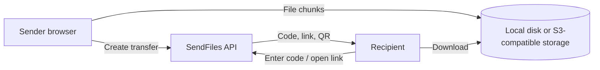

<div align="center">
  
  <h1>SendFiles</h1>
  <p><strong>Big files. No account. Just send.</strong></p>
  <p>Move files between your phone, tablet, and computer with a short code, a link, or a QR scan.</p>
  <p>
    
    
    
    
  </p>
</div>

---

## What is SendFiles?

**SendFiles is a self-hostable, cross-device file transfer app.** Choose files on one device, then open the transfer on another using a six-character code, a shareable link, or a QR code. No recipient account or app installation is needed.

Files are split into chunks while uploading. With an S3-compatible provider such as Cloudflare R2 configured, the browser sends those chunks directly to object storage using temporary signed URLs. In local mode, SendFiles stores the chunks on the server's disk instead. Transfers expire automatically; the default lifetime is **34 hours**.

> SendFiles is the software you can run yourself. You choose the host and storage provider, and their limits, costs, and persistence policies apply.

## How a transfer works

1. **Choose files** — select or drag in files (up to 5 GB each; up to 50 files per transfer).
2. **Upload** — SendFiles uploads in 10 MiB chunks and shows progress, speed, and estimated time remaining.
3. **Share** — copy the six-character code or link, or let the recipient scan the QR code.
4. **Receive** — open the link or enter the code on another device to view and download the files.
5. **Expire** — the transfer is automatically cleaned up after its configured lifetime (34 hours by default).



## Features

- **Cross-device sharing** with six-character transfer codes, deep links, and QR codes.
- **Large uploads** up to 5 GB per file and 50 files in one transfer.
- **Multipart uploads** using configurable 10 MiB chunks, with browser-side progress, speed, and ETA.
- **Upload controls** to pause, resume, cancel, or remove a transfer using the sender's authorization token.
- **Two storage modes:** local disk for development and S3-compatible object storage (including Cloudflare R2) for deployments.
- **Automatic expiration and cleanup** for completed transfers and abandoned multipart uploads.
- **No account required** for senders or recipients.
- **Responsive interface** with light and dark themes.
- **Transfer-code rate limiting** to make code guessing harder.

## Tech stack

| Area | Tools |
| --- | --- |
| Web app | React 19, Vite, Framer Motion |
| API | Node.js, Express |
| Database | SQLite via Node.js `node:sqlite` |
| File storage | Local disk or S3-compatible object storage |
| Transfer UI | Lucide icons, QR generation and scanning |

## Run it locally

### Requirements

- Node.js 22 or newer
- npm

### Install and start

```bash
git clone https://github.com/<your-account>/SendFiles.git
cd SendFiles
npm run install:all
npm run dev
```

The development runner starts the frontend and API:

- Web app: <http://localhost:5173>
- API health check: <http://localhost:4000/api/health>

Local disk storage is selected by default, so you can try the app without cloud-storage credentials. Runtime data is written under `data/` and is excluded from Git.

To run a production-style build locally:

```bash
npm run build
npm start
```

The Express server serves the built frontend from `client/dist` when that directory exists.

## Configuration

Copy `server/.env.example` to `server/.env` and adjust the values for your environment:

```env
PORT=4000
NODE_ENV=development
CLIENT_URL=http://localhost:5173

# local (default) or an S3-compatible provider such as R2
STORAGE_PROVIDER=local
LOCAL_STORAGE_DIR=./data/storage
DATABASE_PATH=./data/sendfiles.db

# Set these when using Cloudflare R2 or another S3-compatible endpoint
R2_ACCOUNT_ID=
R2_ACCESS_KEY_ID=
R2_SECRET_ACCESS_KEY=
R2_BUCKET_NAME=sendfiles-bucket
R2_CUSTOM_DOMAIN=

MAX_FILE_SIZE_BYTES=5368709120
MULTIPART_CHUNK_SIZE_BYTES=10485760
TRANSFER_EXPIRATION_HOURS=34
RATE_LIMIT_CODE_MAX=20
RATE_LIMIT_CODE_WINDOW_MINUTES=15
SECURITY_SECRET=replace-with-a-long-random-secret
```

### Cloudflare R2 / S3-compatible storage

Set `STORAGE_PROVIDER=r2` and provide valid credentials and an endpoint. For Cloudflare R2, set `R2_ACCOUNT_ID`, `R2_ACCESS_KEY_ID`, and `R2_SECRET_ACCESS_KEY`; the endpoint is derived from the account ID. For another S3-compatible service, configure `S3_ENDPOINT` and `S3_REGION` as needed. The storage adapter also accepts `s3` and `b2` as provider names.

Configure the bucket's CORS policy to allow your deployed app origin and the `GET`, `PUT`, and `HEAD` methods. The browser needs to read the `ETag` response header for multipart upload completion. Keep the bucket private and use credentials scoped to the bucket.

**Production note:** set a strong, private `SECURITY_SECRET`. Use persistent storage for the SQLite database and local files if running in local-storage mode; many container and free-tier hosts use ephemeral disks. Cloud object storage avoids routing file payloads through the API server.

## Deploy

The repository includes a `Dockerfile`, `render.yaml`, and `fly.toml` as starting points. The app can run as a single service: build the client, then start the Express server.

For a standard Node.js host:

```bash
npm run build
npm start
```

For a split frontend/backend deployment, build the frontend with Vite and set `VITE_API_BASE` to the deployed API base URL. Configure `CLIENT_URL` on the API to match the frontend origin. In either setup, configure durable storage and production credentials before accepting real uploads.

## Tests

Run the end-to-end transfer test:

```bash
npm run test:e2e
```

The test exercises the local transfer flow, including multipart upload and download.

## Project layout

```text
client/                 React + Vite interface
  public/favicon.svg    SendFiles logo
  src/components/      Upload, receive, QR, and transfer UI
  src/utils/            API client and multipart uploader
server/                 Express API and storage adapters
  src/config/           Environment and SQLite configuration
  src/services/         Transfer lifecycle and storage logic
  tests/                End-to-end transfer test
scripts/                Local development runner
Dockerfile              Container build
render.yaml             Render service template
fly.toml                Fly.io configuration
```

## License

SendFiles is released under the [MIT License](LICENSE).
